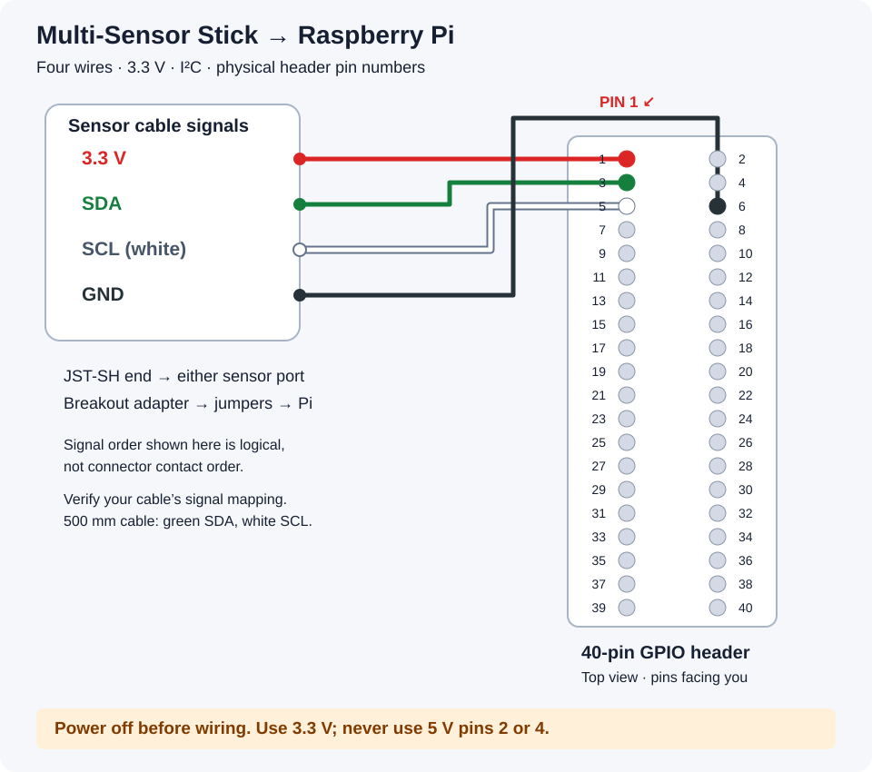

# Connect a Pimoroni Multi-Sensor Stick to Raspberry Pi

For Raspberry Pi computers with a standard **40-pin GPIO header** (not Raspberry Pi Pico).



The diagram is an SVG drawn with code. Colours match Pimoroni’s **500 mm JST-SH to JST-SH cable with black shrouding**: red = 3.3 V, black = GND, green = SDA, white = SCL. White is outlined in grey for visibility.

## What you need

- Pimoroni Multi-Sensor Stick (PIM745).
- Pimoroni’s **500 mm JST-SH to JST-SH cable with black shrouding**, plus a **Qwiic/STEMMA QT breakout adapter and female DuPont jumper wires** to reach the Pi header. The 500 mm cable has JST-SH plugs at both ends and cannot plug directly onto GPIO pins.
- A Raspberry Pi with a fitted GPIO pin header.

## Connect the four wires

**Shut down the Pi and disconnect power before wiring.** Plug the cable into either sensor connector and the breakout adapter, then connect the adapter to the Pi with female DuPont jumper wires as follows. Verify each cable wire's signal using its supplier's pinout; the sensor box in the diagram is a signal list, not a drawing of connector contact order.

| Cable colour | Sensor signal | Pi physical pin | Pi function |
|---|---|---:|---|
| 🔴 Red | 3.3 V | **1** | 3.3 V power |
| ⚫ Black | GND | **6** | Ground |
| 🟢 Green | SDA | **3** | GPIO2 / I²C data |
| ⚪ White | SCL | **5** | GPIO3 / I²C clock |

**Use physical pin numbers, not GPIO numbers. Do not connect sensor power to 5 V pins 2 or 4.** Locate pin 1 using your Pi model's official pinout or board marking before connecting. The diagram deliberately shows the header separately from the Pi board so it does not imply a USB/HDMI orientation.

## Enable and check I²C

Reconnect power, boot Raspberry Pi OS, and run:

```bash
sudo raspi-config
```

Select **Interface Options → I2C → Enable**, then exit. Install the detection tool and scan:

```bash
sudo apt install i2c-tools
i2cdetect -y 1
```

Expected addresses: **`0x23`** (LTR559 light/proximity), **`0x6a`** (LSM6DS3 accelerometer/gyroscope), and **`0x76`** (BME280 temperature/humidity/pressure).

## Sources

- [Pimoroni Multi-Sensor Stick specifications and software](https://shop.pimoroni.com/products/multi-sensor-stick)
- [Pimoroni Qw/ST connector and pinout guide](https://learn.pimoroni.com/article/what-is-qwst)
- [Pimoroni cable specifications and 500 mm colour mapping](https://shop.pimoroni.com/products/jst-sh-cable-qwiic-stemma-qt-compatible)
- [Raspberry Pi GPIO documentation](https://www.raspberrypi.com/documentation/computers/raspberry-pi.html)
- [Raspberry Pi configuration documentation](https://www.raspberrypi.com/documentation/configuration/)
